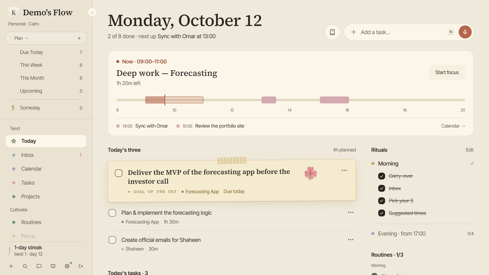
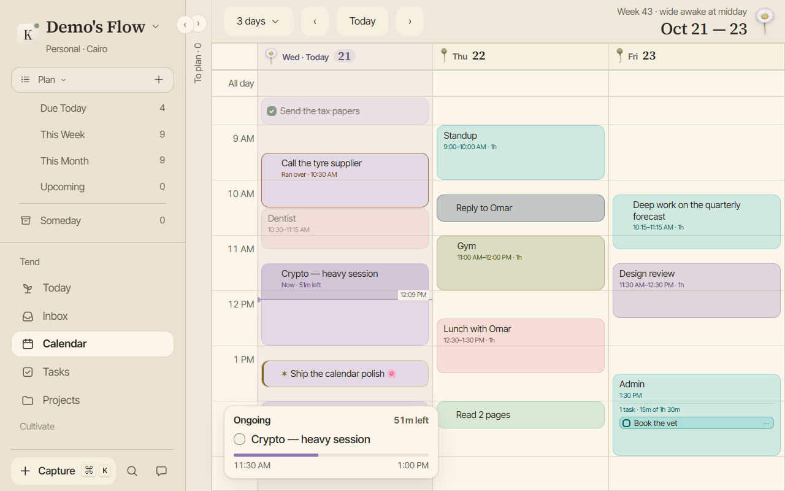
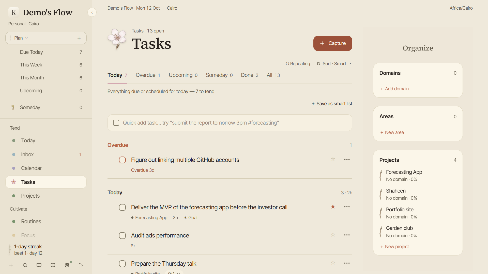
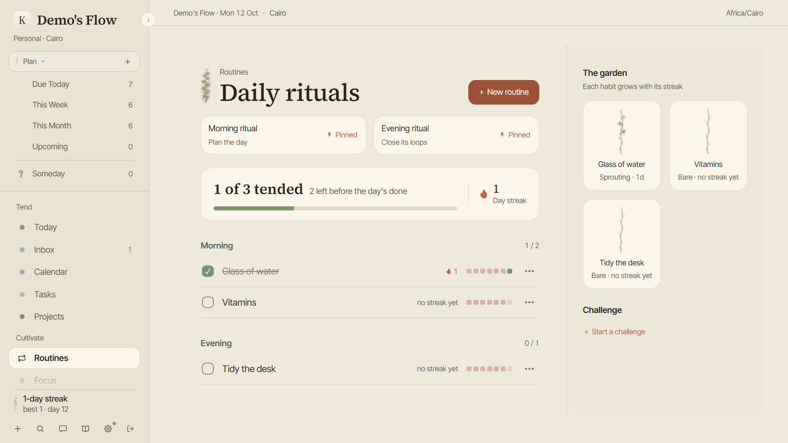
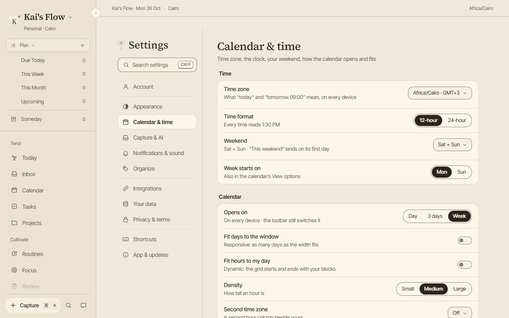
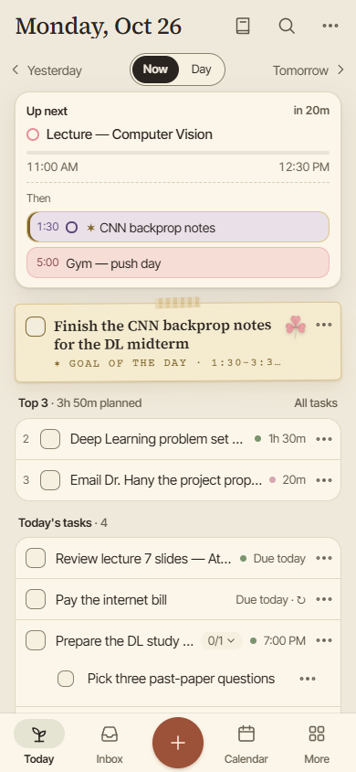
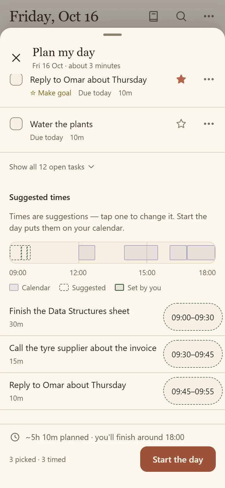
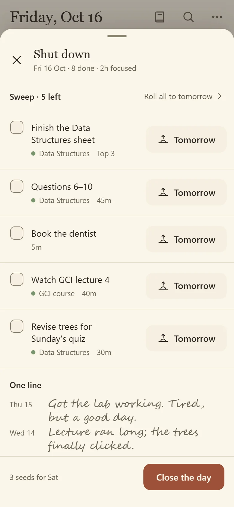
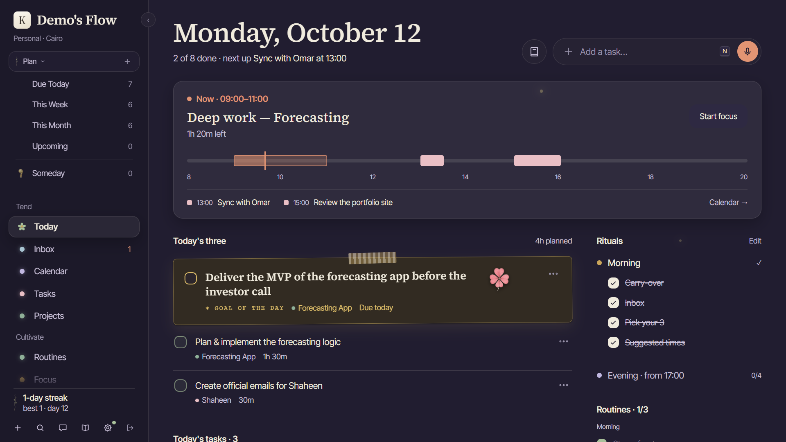

# Kai's Flow

**One person's whole life in one app, for $0 a month.**

Tasks, calendar, habits, rituals, journal, people and reading, in one app that syncs between 
your laptop and your phone, works offline, and files what you say into the right place.

[**Download**](#-download) · [**Install notes**](#-first-time-install) · [**Tour**](#-a-tour) · [**Features**](#-what-it-does) · [**Privacy**](#-privacy) · [**Roadmap**](#-whats-growing) · [**Help**](#-help-and-feedback) · [**Website**](https://kais-flow-site.khairyshhn1.workers.dev)

 

Today, the home screen: what's on now and next, your Top 3 with one goal, your rituals and routines.

---

## 📥 Download

Every link below always points at the newest release.

| Platform | Get it | Notes |
| :-- | :-- | :-- |
| 🪟 **Windows** | [**kais-flow-windows-setup.exe**](https://github.com/khairyKY/kais-flow-releases/releases/latest/download/kais-flow-windows-setup.exe) | Installs just for you, no admin password. A K sits by the clock for quick capture. |
| 🍎 **macOS** | [**kais-flow-mac.dmg**](https://github.com/khairyKY/kais-flow-releases/releases/latest/download/kais-flow-mac.dmg) | **Coming with the next release.** Until then, use the web app. |
| 🤖 **Android** | [**kais-flow.apk**](https://github.com/khairyKY/kais-flow-releases/releases/latest/download/kais-flow.apk) | Not on the Play Store yet, so you install it yourself. It takes about a minute. |
| 📱 **iPhone and iPad** | [**Open the web app**](https://kais-flow.kaidagoat.workers.dev) | Add it to your Home Screen and it runs in its own window, offline too. |
| 🌐 **Any browser** | [**kais-flow.kaidagoat.workers.dev**](https://kais-flow.kaidagoat.workers.dev) | Install it from the address bar in Chrome or Edge to get its own window. |

One free account works everywhere, and your days sync between all of them. Older versions are on the [Releases](https://github.com/khairyKY/kais-flow-releases/releases) page.

---

## 🧭 First-time install

The apps aren't signed by Microsoft or Apple yet (that costs money every year, and this app is free), so your computer asks you to confirm once. That's expected.

<b>🪟 Windows</b>

1. Open `kais-flow-windows-setup.exe` from your Downloads.
2. If a blue **"Windows protected your PC"** box appears, click **More info**, then **Run anyway**.
3. The installer finishes on its own and opens Kai's Flow. Sign in or make an account.

<b>🍎 macOS</b> (coming with the next release)

1. Open `kais-flow-mac.dmg` and drag **Kai's Flow** into **Applications**.
2. Open it from Applications. macOS will say it can't check the app and only offer *Move to Trash* or *Done*. Click **Done**.
3. Open **System Settings › Privacy & Security**, scroll down to **Security**, and click **Open Anyway** next to Kai's Flow. (The button only shows for about an hour after you tried to open the app.)
4. Enter your Mac password, then click **Open**.

You only do this once. Updates after that install without asking again.

<b>🤖 Android</b>

1. On your phone, download `kais-flow.apk` and open it.
2. Android asks whether your browser (or Files app) may install apps. Tap **Settings**, switch on **Allow from this source**, then go back.
3. Tap **Install**, then **Open**.

The "allow" step happens only once. Step-by-step pictures: [Install on Android](https://kais-flow-site.khairyshhn1.workers.dev/guides/install-android/).

<b>📱 iPhone and iPad</b>

There's no App Store app (yet). The web app does the job:

1. Open [the web app](https://kais-flow.kaidagoat.workers.dev) in **Safari**.
2. Tap **Share**, then **Add to Home Screen**, then **Add**.
3. Open it from the new icon. It gets its own window and works offline.

### 🔄 Updates

**The apps update themselves.** On Windows, press **Update** when it's offered and watch the progress line. On Android, **Settings › App › Check for updates** finds the newest version and installs it over the top, keeping everything. The web app is always the newest version. What changed in each release is in the [Field notes](https://kais-flow-site.khairyshhn1.workers.dev/field-notes/).

---

## Why this exists

I paid for [Akiflow](https://akiflow.com) (~$19–34 a month) to get one inbox, a fast command bar and a calendar I could drag tasks onto. My journal, habits, people and reading lived in four other apps. Then I watched Jerad Hill build an AI life dashboard with voice capture, streaks, a personal CRM and a "what's slipping" view, and it did the half Akiflow didn't.

**Kai's Flow is both, in one app.** It replaces Akiflow and covers the rest of a life too, and it has to stay:

| | The rule | What it means for you |
| :-- | :-- | :-- |
| 🆓 | **Free** | No trial, no tiers, no card. It stays free. |
| 🔄 | **Everywhere** | Windows, Android, the web, and soon macOS, all showing the same data live. Works offline; changes sync when you're back. |
| 🔐 | **Private** | No ads, no trackers, nothing to sell. The AI it uses doesn't train on your words and keeps nothing after replying. |
| ⚡ | **Fast to capture** | Anything you think of reaches the Inbox in one keystroke, one tap, or one held button. |
| 🪶 | **Light** | Small downloads, quick to open, no clutter. It looks like a paper journal, not a dashboard. |

---

## 🌿 A tour

<table>
<tr>
<td width="50%"></td>
<td width="50%"></td>
</tr>
<tr>
<td><b>Calendar.</b> Your own calendar, not an embedded Google one. Drag a task onto a time, pull the edge to change how long, and drop tasks into a Time slot like "Code block". Your Google calendars can sit beside your blocks, both ways.</td>
<td><b>Tasks.</b> Smart lists, lengths, priorities (<code>!</code> <code>!!</code> <code>!!!</code>), repeats, subtasks, labels and snooze. Domains → Areas → Projects can be renamed and moved freely.</td>
</tr>
<tr>
<td></td>
<td></td>
</tr>
<tr>
<td><b>Routines.</b> Habits are kept apart from tasks and fold by time of day. Each keeps a streak that forgives one missed day a month, and a vine that grows with it.</td>
<td><b>Settings.</b> Searchable (<kbd>Ctrl</kbd> <kbd>F</kbd>), in plain language, and the same on every device: your time zone, your weekend, how the calendar opens and fits.</td>
</tr>
</table>

<table>
<tr>
<td width="33%" align="center"></td>
<td width="33%" align="center"></td>
<td width="33%" align="center"></td>
</tr>
<tr>
<td align="center"><b>Now and next.</b> What's running, what comes after, and your three.</td>
<td align="center"><b>Plan my day.</b> Three minutes with your tea.</td>
<td align="center"><b>Shut down.</b> Close the day, one line in the journal.</td>
</tr>
</table>

<b>Night theme.</b> After dark the palette turns plum, and the evening Shut down offers to close the garden for the night.

> [!NOTE]
> Screenshots use sample data, because the real app holds a real person's life.

---

## ✨ What it does

### Capture: get it out of your head

- **Type it or say it.** Press <kbd>Ctrl</kbd> <kbd>K</kbd> or tap the round button and write it the way you'd say it: `call Omar tomorrow 3pm 30m !! #forecasting`. The date, time, length, priority and project are picked out for you. Or hold the button and talk; slide up to go hands-free.
- **An Inbox that waits for you.** Everything lands in one place until you file it as a task, a note, or nothing. Turn on *File captures for me* and the AI files the ones it's sure about.
- **Paper capture.** Some days want a pen. The Notebook page lays out your day to copy by hand; photograph your notes and they become tasks.
- **From anywhere.** The Android share sheet, 34 home-screen widgets, the Windows tray, and a private capture link for Shortcuts, Tasker or a bookmarklet. GitHub issues assigned to you can arrive in the Inbox too.
- **Bring what you have.** Import from Akiflow, TickTick or any CSV. Running it twice adds no duplicates.

### Plan: decide what today is for

- **Plan my day.** Pick your Top 3, star one as the goal of the day, and each gets a suggested time on your calendar.
- **Today.** One page: what's on now with a countdown, what's next, your three, and the rest. Step to tomorrow or any day with ‹ ›.
- **Your own calendar.** Day, N-day, week and month. Drag tasks onto times, resize, and drop tasks into Time slots that carry them along. A rail beside the week holds what's overdue, what's for today, and your Inbox.
- **Google Calendar, both ways.** Your Google events sit on the grid beside your blocks, and your plan goes back to Google as private busy time. Disconnect, and what it wrote is taken out again.
- **Plan… on any task.** It looks at your real calendar for the next free slot, tomorrow first thing, your weekend, or next week.
- **Focus.** A focus timer with a small floating widget, and rounds that end with a soft chime.
- **Every change has an Undo.** <kbd>Ctrl</kbd> <kbd>Z</kbd> takes back the last one.

### Tend: keep a life from drifting

- **Rituals.** Plan my day in the morning and Shut down in the evening: tick what's done, move what isn't, and pick tomorrow's three.
- **Routines, streaks and challenges.** Morning, afternoon, evening and anytime habits, with streaks, goals and 30-day challenges.
- **Slipping.** Projects and areas you haven't touched in a while are gently flagged.
- **Reminders that arrive.** On Windows, Android and the web. A reminder carries *Done* and *Tomorrow*, quiet hours keep the night quiet, and task names stay off the lock screen until you choose.
- **Projects.** Milestones, checklists you can reuse as templates, and a percentage that grows a wisteria.
- **Your own clock.** Today, reminders and the morning digest follow your time zone wherever you are.

### Remember: ask your own life questions

- **Journal.** A line or a page, more than one entry a day.
- **Library.** Books, quotes and notes, with your Kindle highlights and Goodreads shelves.
- **People.** Birthdays, how you know them, and notes on the last time you spoke.
- **Search** (<kbd>Ctrl</kbd> <kbd>/</kbd>) across everything, by word and by meaning.
- **Chat** (<kbd>Ctrl</kbd> <kbd>J</kbd>). Ask about your day in your own language. It can also add, move and finish things: it shows what it will do, you confirm, and one Undo takes it all back.
- **Resurfacing.** Now and then Today brings back something from weeks ago: a note, a quote, an old task. Every button settles it.
- **Herbarium.** Finished projects are pressed like flowers in a book, and you can restore them.
- **Your AI assistant, too.** Connect Claude or another assistant to read your garden and, if you allow it, change things for you. Journal and People stay off unless you switch them on.

---

## 🌸 Every plant is a number

The botanical art does a job. **Every illustration shows a real value**, and they all follow the same rules, so you can read your day without reading any text.

| | Plant | Lives on | It shows | Stages |
| :-: | :-- | :-- | :-- | :-- |
|  | **Hydrangea** | Inbox | how much is waiting | none · a few (1–4) · some (5–19) · heavy (20+) |
|  | **Vine** | Routines | your streak | bare · sprouting (1–6 days) · flowering (7–29) · lush (30+) |
|  | **Cherry** | Tasks, Today | today's progress | bud → opening → bloom → fallen (all done) |
|  | **Daisy** | Calendar | the time of day | morning · midday · evening, closed on past and future days |
|  | **Fern** | Journal, Library | how far along | coiled → unfurling → full |
|  | **Wisteria** | Projects | milestones done | 0% → 100% in 20% steps |
|  | **Clover** | Goal of the Day | luck for the one thing that matters | |

All of it sits on paper texture and washi tape, with a day and a night palette, small sounds you can turn off, and motion that calms down when your system asks for reduced motion. Emoji look the same on Windows, Android and macOS.

---

## ⌨️ Keyboard first

Everything has a key. Press <kbd>?</kbd> anywhere in the app for the full list.

<table>
<tr><th>Anywhere</th><th>Task lists</th><th>Inbox</th></tr>
<tr valign="top"><td>

| | |
| :-- | :-- |
| <kbd>Ctrl</kbd> <kbd>K</kbd> | Command bar |
| <kbd>/</kbd> | Search |
| <kbd>Ctrl</kbd> <kbd>J</kbd> | Chat |
| <kbd>Ctrl</kbd> <kbd>Z</kbd> | Undo |
| <kbd>Ctrl</kbd> <kbd>,</kbd> | Settings |
| <kbd>n</kbd> | New task |
| <kbd>i</kbd> / <kbd>u</kbd> | Inbox / Upcoming |
| <kbd>?</kbd> | All shortcuts |

</td><td>

| | |
| :-- | :-- |
| <kbd>j</kbd> <kbd>k</kbd> | Move |
| <kbd>e</kbd> or <kbd>Space</kbd> | Complete |
| <kbd>t</kbd> | Top 3 on / off |
| <kbd>h</kbd> | Goal of the day |
| <kbd>1</kbd> <kbd>2</kbd> <kbd>3</kbd> | Today · Tomorrow · Next week |
| <kbd>d</kbd> | Plan… |
| <kbd>f</kbd> | Start focus |
| <kbd>x</kbd> / <kbd>#</kbd> | Select / Delete |

</td><td>

| | |
| :-- | :-- |
| <kbd>↑</kbd> <kbd>↓</kbd> | Move |
| <kbd>e</kbd> | File it |
| <kbd>Space</kbd> | Done now |
| <kbd>p</kbd> | Pick a date |
| <kbd>d</kbd> | Dismiss |
| <kbd>s</kbd> | Snooze |
| <kbd>r</kbd> | Restore |

</td></tr>
</table>

**Command bar grammar:** `<title> [date/time] [30m | 1h30m] [! | !! | !!!] [#project] [*label] [every week] [// notes]`. Everything but the title is optional, and the extras are taken out of the title for you. <kbd>Ctrl</kbd> <kbd>2</kbd> makes it an event instead of a task.

---

## 🔒 Privacy

Kai's Flow is a journal, so it behaves like one.

- **No ads, no selling data.** There is nothing to sell. No trackers, no analytics scripts, no cookie banner.
- **Each account sees only its own data.** Your account lives in the EU (Frankfurt).
- **AI that forgets.** Capture and chat use [Groq](https://groq.com), which doesn't train on your words and, with zero data retention, keeps nothing after replying. Search runs inside the app's own database, not through an AI company.
- **The most personal parts stay off your device.** Your journal and notes about people aren't kept in the offline copy on your phone or laptop.
- **Yours to take.** Ask, and you'll get everything you've written. Delete your account, and all of it goes with it.

The whole policy, in plain words: [Privacy](https://kais-flow-site.khairyshhn1.workers.dev/privacy/) · [Terms](https://kais-flow-site.khairyshhn1.workers.dev/terms/).

---

## 🌱 What's growing

| When | What |
| :-- | :-- |
| **Now** | Fixes from living with v1.5 · the macOS app |
| **Next** | Being weighed: start dates, attachments on tasks, a quick-add key on Windows |
| **Later** | Email → Inbox · more themes · an iPhone app *(if it ever stops costing money)* |

The full roadmap, drawn as a garden: [What's growing](https://kais-flow-site.khairyshhn1.workers.dev/growing/). Every release so far: [Field notes](https://kais-flow-site.khairyshhn1.workers.dev/field-notes/).

---

## 💬 Help and feedback

Everything lives on the website:

- **Guides:** [Getting started](https://kais-flow-site.khairyshhn1.workers.dev/guides/getting-started/), [Install on Windows](https://kais-flow-site.khairyshhn1.workers.dev/guides/install-windows/), [Install on Android](https://kais-flow-site.khairyshhn1.workers.dev/guides/install-android/), [Capture from anywhere](https://kais-flow-site.khairyshhn1.workers.dev/guides/capture-from-anywhere/), [Import](https://kais-flow-site.khairyshhn1.workers.dev/guides/import/), [Keyboard shortcuts](https://kais-flow-site.khairyshhn1.workers.dev/guides/keyboard-shortcuts/) and [all the rest](https://kais-flow-site.khairyshhn1.workers.dev/guides/).
- **Found a bug, or have an idea?** Write in. The email address is at the bottom of every page on [the website](https://kais-flow-site.khairyshhn1.workers.dev).

---

## 🙏 Standing on

- **[Akiflow](https://akiflow.com)**: the product being replaced, and the standard for inbox, command bar and time-blocking.
- **Jerad Hill**: his AI life dashboard supplied the Slipping idea, voice capture with AI filing, and the lesson that *an unsure AI should leave things in the inbox*.
- **[Twemoji](https://github.com/twitter/twemoji)** by Twitter, licensed [CC-BY 4.0](https://creativecommons.org/licenses/by/4.0/).
- **[FullCalendar](https://fullcalendar.io)**, **[chrono-node](https://github.com/wanasit/chrono)**, **[rrule](https://github.com/jkbrzt/rrule)**, **[TanStack Query](https://tanstack.com/query)**, **[dnd-kit](https://dndkit.com)**, **[Supabase](https://supabase.com)**, **[Groq](https://groq.com)**, **[Tauri](https://tauri.app)** and **[Capacitor](https://capacitorjs.com)**.
- Type: **Source Serif 4**, **Inter Tight**, **Courier Prime** and **Caveat** (SIL Open Font License).

## 📜 License

Proprietary — all rights reserved. This repository only hosts the downloads.

 

 
<i>pressed & kept, one day at a time</i>

